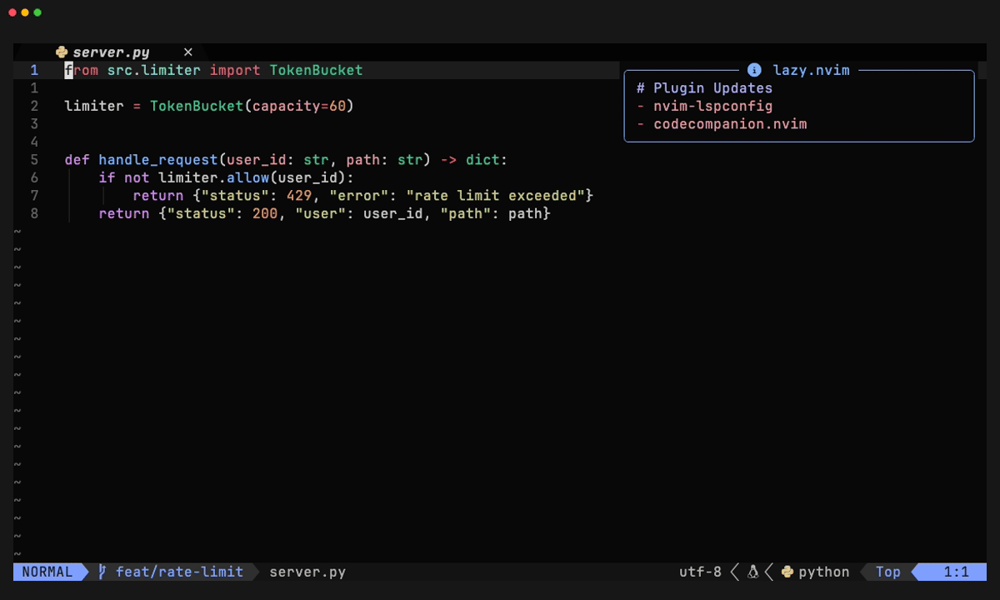

# pretend.nvim

Neovim front end for [git-pretend]: review your PR in the editor you already use, as if you had just written it.



While pretending, `HEAD` is at the older commit and the working tree holds the newer one's files
as uncommitted changes. So gitsigns marks every changed line, LSP and grep see the newer code,
and your usual diff view (codediff.nvim, diffview.nvim, `:Gdiff`...) shows the range as "your
changes". This plugin adds:

- a commit picker: one commit, or <kbd>Tab</kbd> two for the range between them
- an optional in-buffer inline diff overlay showing deleted and previous versions of changed lines
  right in your live buffer (also works on normal uncommitted changes)
- if you want, opening a diff view when you start (codediff.nvim or diffview.nvim) and closing
  it when you stop
- reloading buffers when you start and stop, and reverting unsaved edits made while pretending
- a reminder on startup if a previous session left you pretending, and a statusline component

All the git work is done by the git-pretend CLI, so you can also start in a terminal and stop in
Neovim, or the other way round.

[git-pretend]: https://github.com/alex-k03/git-pretend

## Requirements

- Neovim 0.10+
- [git-pretend] on your `PATH` (or set `cmd`)
- Optional: [snacks.nvim] for a commit picker with fuzzy search and diff previews (otherwise
  uses a built-in floating picker with `<Tab>` two-commit range selection), and [codediff.nvim]
  or [diffview.nvim] if you want `open` / `close`

[snacks.nvim]: https://github.com/folke/snacks.nvim
[codediff.nvim]: https://github.com/esmuellert/codediff.nvim
[diffview.nvim]: https://github.com/sindrets/diffview.nvim

## Install

With [lazy.nvim](https://github.com/folke/lazy.nvim):

```lua
{
    "alex-k03/pretend.nvim",
    event = "VeryLazy", -- for the startup reminder and statusline
    opts = {},
    keys = {
        { "<leader>gv", function() require("pretend").toggle() end, desc = "Pretend: pick commits, or stop" },
        { "<leader>go", function() require("pretend").toggle_overlay() end, desc = "Pretend: toggle inline diff overlay" },
    },
}
```

## Usage

| | |
|---|---|
| `:Pretend` | pick commits (or show the status while pretending) |
| `:Pretend main...` | anything git-pretend takes: `<commit>`, `<old> <new>`, `<old>..<new>`, `<base>...<new>` |
| `:Pretend status` | what you are pretending |
| `:Pretend overlay` | toggle the in-buffer inline diff overlay (old/deleted lines) |
| `:Pretend done` | stop: discards the pretend changes and goes back |
| `require("pretend").toggle()` | pick and start, or stop if pretending |
| `require("pretend").toggle_overlay()` | toggle the inline diff overlay (works outside pretending too) |

Pretending is for reading: stopping discards anything you edited meanwhile. git-pretend saves
those edits as a patch in `.git/pretend-discarded/` first, and unsaved buffers are reverted.

You can't start with unsaved buffers in the repository, since the checkout would put your edits
on top of different code.

### Seeing the changes

Nothing opens by default: while pretending, whatever you already use to look at your changes
shows the range. For example `:CodeDiff`, `:DiffviewOpen`, `:Git`, gitsigns' hunk navigation, or
`git diff` in a terminal. To have one opened on start and closed on stop, set `open` and `close`
(see below).

### Statusline

While pretending `HEAD` is detached, so your statusline's branch component shows a commit hash.
`branch()` gives the branch you will go back to instead, and `statusline()` a short `pretend`
marker. For lualine:

```lua
local function pretend() return package.loaded.pretend and require("pretend") end

sections = {
    lualine_b = {
        { "branch", fmt = function(name) return pretend() and pretend().branch() or name end },
        { function() return pretend().statusline() end, cond = function() return pretend() and pretend().statusline() ~= "" end },
        "diff",
        "diagnostics",
    },
},
```

Both are cached and refreshed when you start or stop, on focus and on `:cd`, so they cost nothing
per redraw.

### Other uses of the picker

`pick_commits` gives you the picker without pretending, for example to open a commit or range in
your diff view:

```lua
require("pretend").pick_commits({ title = "Diff commits" }, function(from, to, cwd)
    vim.cmd(("CodeDiff -C %s %s %s"):format(vim.fn.fnameescape(cwd), from, to))
end)
```

## Configuration

Defaults:

```lua
require("pretend").setup({
    -- The git-pretend executable, or a command list to run it with
    cmd = "git-pretend",
    -- Automatically show the in-buffer inline diff overlay (previous/deleted lines) while
    -- pretending; toggle anytime with :Pretend overlay or require("pretend").toggle_overlay()
    overlay = false,
    -- After starting: false opens nothing, "auto" opens codediff.nvim or diffview.nvim
    -- if installed, or a function(state)
    open = false,
    -- After stopping: false closes nothing, "auto" closes the codediff / diffview tabs
    -- opened since starting (by `open` or by hand; their diff is gone), or a function()
    close = false,
    -- Remind on startup when a previous session left you pretending
    startup_notice = true,
})
```

`:checkhealth pretend` checks that the CLI is found.

## License

MIT
